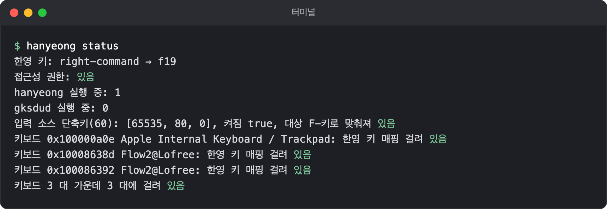

<p align="center"></p>

<h1 align="center">hanyeong</h1>

<p align="center">Mac 에서 <b>누르는 순간</b> 바뀌는 한영 키</p>

오른쪽 ⌘ 키 하나로 한글과 영문을 오갑니다. 설정 창도, 화면에 떠다니는 상자도 없고 메뉴바에 `한`
아이콘 하나만 있습니다. [gksdud](https://github.com/codingnoye/gksdud) 의 전환 방식을 Rust 로 다시
만들었습니다.

## 왜 필요한가요?

macOS 의 한영 전환 단축키는 키를 **뗄 때** 입력 소스를 바꿉니다. 그래서 한영 키를 누르고 손을 떼기
전에 다음 글자를 치면, 그 글자는 아직 바뀌기 전의 언어로 들어갑니다. 빠르게 칠수록 자주 생깁니다.

hanyeong 은 키를 **누르는 순간** 바꿉니다.

<p align="center"></p>

## 특징

- **아무것도 띄우지 않습니다.** 전환할 때 화면에 상자를 그리지 않습니다. 지금이 한글인지 영문인지는
  macOS 의 입력 메뉴에 그대로 맡깁니다.
- **가만히 있을 때 일하지 않습니다.** 키를 누르지 않는 30초 동안 CPU 를 0.01초도 쓰지 않습니다.
  메모리는 12 MB 입니다.
- **작습니다.** 실행 파일은 약 0.45 MB 이고, 외부 라이브러리를 하나도 쓰지 않습니다.
- **끝나면 원래대로 돌려놓습니다.** 바꿔 둔 키 설정과 시스템 단축키를 종료할 때 되돌립니다. 강제로
  꺼져도 원래 값을 기억하고 있어서, 다시 켰다가 끄거나 `hanyeong restore` 를 돌리면 돌아옵니다.

macOS 전용입니다. Apple Silicon Mac, macOS 27.2 에서 만들고 확인했습니다.

## 설치

**준비물**

- Xcode 명령행 도구: 없으면 `xcode-select --install`
- [Rust](https://rustup.rs): 필요한 버전(1.100.0)은 저장소에 적혀 있어서 rustup 이 알아서 받습니다

> gksdud 를 쓰고 있었다면 먼저 종료하고 로그인 항목에서 빼 주세요. 둘이 함께 돌면 서로의 키를
> 주고받기 때문에, hanyeong 은 gksdud 가 켜져 있으면 시작하지 않습니다.

**1. 내려받기**

```sh
git clone https://github.com/taeyun16/hanyeong.git
```

```sh
cd hanyeong
```

**2. 서명 인증서 만들기** (처음 한 번만)

```sh
tools/setup_signing.sh --create
```

이 Mac 의 로그인 키체인에 hanyeong 전용 서명 인증서를 만듭니다. 이게 있어야 나중에 새 버전을 설치해도
접근성 권한이 그대로 남습니다. 건너뛰면 설치할 때마다 권한을 다시 줘야 합니다.

**3. 설치하기**

```sh
tools/install.sh
```

빌드해서 `~/Applications/hanyeong.app` 에 넣고, 로그인할 때 저절로 켜지도록 등록한 뒤 바로 켭니다.

**4. 접근성 권한 주기**

처음 켜면 `시스템 설정 › 개인정보 보호 및 보안 › 손쉬운 사용` 화면이 열립니다. 목록에서 **hanyeong**
을 켜 주세요. 목록에 없으면 `+` 를 눌러 `~/Applications/hanyeong.app` 을 더합니다. 켜고 나면 10초 안에
메뉴바에 `한` 이 나타납니다.

키 입력을 받아야 하는 도구라서 이 권한이 꼭 필요합니다. hanyeong 은 다른 키가 오면 어떤 키인지(키
코드)만 보고 바로 흘려보냅니다. 입력한 내용을 저장하거나 어디로 보내지 않습니다.

## 쓰는 법

**오른쪽 ⌘ 을 누르면 바뀝니다.** 그게 전부입니다.

메뉴바의 `한` 을 누르면 메뉴가 나옵니다.

| 메뉴 | 하는 일 |
|---|---|
| 일시정지 | 잠시 끕니다. 그동안에는 macOS 원래대로 키를 뗄 때 바뀝니다 |
| hanyeong 종료 | 끄고 바꿔 둔 설정을 되돌립니다. 저절로 다시 켜지지 않습니다 |

### 잘 켜져 있는지 확인하기

```sh
~/Applications/hanyeong.app/Contents/MacOS/hanyeong status
```

아무것도 바꾸지 않고 지금 상태만 보여 줍니다. 아래처럼 나오면 잘 동작하는 것입니다.

<p align="center"></p>

### 다른 키를 쓰고 싶다면

터미널에서 직접 켤 수도 있습니다. 이때는 그 터미널 앱에 접근성 권한이 있어야 합니다.

```sh
cargo build --release --locked -p hanyeong
```

```sh
./target/release/hanyeong run --key right-option
```

| 명령 | 하는 일 |
|---|---|
| `run` | 켭니다. Ctrl+C 로 끄면 되돌립니다 |
| `status` | 권한, 단축키, 키보드마다의 설정을 보여 줍니다 |
| `restore` | 강제로 꺼진 뒤 남은 설정을 되돌립니다 |
| `probe` | 실제 기기에서 전환이 얼마나 걸리는지 잽니다(개발용, 입력 소스가 실제로 바뀝니다) |

- `--key`: 한영 키로 쓸 키. `right-command`(기본), `right-option`, `right-control`, `caps-lock`
- `--target`: 안에서 신호로 쓸 F-키. `f13` ~ `f20`(기본 `f19`). 다른 곳에서 쓰지 않는 키를 고릅니다

### 지우기

```sh
tools/install.sh uninstall
```

끄면서 바꿔 둔 설정을 되돌리고, 로그인 항목과 앱을 지웁니다.

## 문제가 생기면

| 이럴 때 | 이렇게 |
|---|---|
| 바뀌지 않고 메뉴바에 `한` 도 없다 | 접근성 권한이 없는 것입니다. 손쉬운 사용 목록에서 hanyeong 을 켜 주세요. 기록은 `~/Library/Logs/hanyeong.log` 에 있습니다 |
| 목록에서 켰는데도 안 된다 | 목록의 항목이 예전 서명의 것입니다. `tccutil reset Accessibility dev.hanyeong` 으로 지우고 `+` 로 다시 더해 주세요 |
| `gksdud 이(가) 돌고 있습니다` 가 나온다 | gksdud 를 종료해 주세요 |
| 강제로 꺼진 뒤 오른쪽 ⌘ 이 이상하다 | hanyeong 을 다시 켜거나 `hanyeong restore` 를 돌려 주세요. 키 설정은 켤 때와 같은 `--key`·`--target` 을 줘야 지워집니다 |
| 지금 상태가 궁금하다 | `hanyeong status` |

## 어떻게 동작하나요?

hanyeong 은 macOS 의 기능 세 가지를 엮습니다.


1. **키보드 키 설정**: 키보드마다 오른쪽 ⌘ 이 F19 로 들어오게 바꿉니다.
2. **이벤트 탭**: F19 가 눌리면 hanyeong 이 그 누름을 막고, 누름과 뗌을 한 쌍으로 곧바로 보냅니다.
   macOS 입장에서는 키를 이미 뗀 것이라 바로 전환합니다.
3. **시스템 단축키**: `이전 입력 소스 선택` 단축키를 F19 로 맞춥니다. 원래 단축키는 따로 기록해 둡니다.

끝날 때는 hanyeong 이 바꾼 것만 되돌립니다. 그 사이에 사용자가 직접 바꾼 단축키는 건드리지 않습니다.

## gksdud 와 견주면

같은 Mac 에서 gksdud 2.1.1 → 도구 없음 → hanyeong 순서로 세 바퀴 번갈아 쟀습니다(2026-11-16,
`tools/compare_live.sh`). 범위는 바퀴마다의 값입니다.

| | gksdud 2.1.1 | hanyeong |
|---|---|---|
| 가만히 둔 30초 동안 쓴 CPU | 0.16 ~ 0.29 초 | 0.00 ~ 0.01 초 |
| 같은 30초의 문맥 전환 | 903 ~ 2,031 번 | 18 ~ 67 번 |
| 메모리 | 27 ~ 28 MB | 12 MB |
| 실행 파일 크기 | 3.28 MB | 0.45 MB |

- 다른 키를 칠 때 늦어지는지는 두 도구 모두 도구가 없을 때와 차이를 가를 수 없었습니다.
- **전환 속도는 비교하지 못했습니다.** 재는 방법이 gksdud 에는 맞지 않았습니다. hanyeong 혼자서는
  중앙값 5.6 ms 였습니다. hanyeong 이 더 빨리 바꾼다고 말할 근거는 없습니다.
- 쉴 때의 CPU 차이는 구조에서 옵니다. gksdud 는 키 설정을 1초마다 확인하고, hanyeong 은 키보드가
  연결됐다는 알림을 받았을 때와 30초에 한 번만 확인합니다.

hanyeong 은 gksdud 의 **한영 키**와 **누를 때 전환**만 옮겼습니다. 설정 창, 한/영 표시, 길게 눌러
대소문자 바꾸기, 특수문자 입력, 키보드별 설정, 자동 업데이트 같은 기능은 없습니다. 이런 기능이
필요하면 gksdud 를 쓰세요.

gksdud 에 없는 것도 하나 있습니다. 같은 방식의 도구가 함께 돌아 서로 키를 주고받기 시작하면, 알아채고
2초 동안 손을 뗍니다.

## 알려진 한계

- 화면이 잠겨 있는 동안에는 키 입력이 오지 않아 동작하지 않습니다.
- 재부팅이나 다시 로그인한 뒤 저절로 켜지는지는 아직 직접 확인하지 않았습니다.
- 접근성 권한은 서명에 묶여 있습니다. 서명 방식을 바꾸면 권한을 한 번 다시 줘야 합니다.
- hanyeong 이 시스템 단축키를 읽고 쓰는 바로 그 순간에 다른 프로그램이 같은 단축키를 바꾸면, 그
  값이 사라질 수 있습니다. macOS 에 이걸 막을 잠금 장치가 없습니다. 자세한 내용은
  [`formal/README.md`](formal/README.md) 에 있습니다.

## 개발

| 폴더 | 내용 |
|---|---|
| `crates/hanyeong-core` | 무엇을 할지 정하는 로직. 시스템을 부르지 않아 어느 OS 에서나 테스트됩니다 |
| `crates/hanyeong-mac` | macOS 를 부르는 코드(이벤트 탭, 키보드 설정, 단축키, 메뉴바). `unsafe` 는 여기에만 있습니다 |
| `crates/hanyeong` | 실행 파일 |

모든 변경은 아래 검사를 거칩니다. 규칙은 [`CLAUDE.md`](CLAUDE.md) 에 있습니다.

| 검사 | 보는 것 |
|---|---|
| 포맷과 린트 | `cargo fmt`, clippy(경고도 실패로). `unsafe` 는 `hanyeong-mac` 에서만, 블록마다 이유를 적는다 |
| 테스트 | `cargo test` |
| 실기기 확인 | macOS 를 부르는 코드를 실제로 띄워 보고, `hanyeong probe` 로 지연을 잰다 |
| 정형 검증 | 단축키를 바꾸고 되돌리는 순서를, 강제 종료를 포함한 모든 경우에 대해 TLA+ 모델로 검사한다 |

```sh
cargo fmt --all --check
```

```sh
cargo clippy --locked --workspace --all-targets -- -D warnings
```

```sh
cargo test --locked --workspace
```

```sh
python3 formal/check.py --replay
```

정형 검증에는 Java 가 필요합니다. 검사 도구 TLC 는 처음 돌릴 때 내려받습니다.

정형 검증은 [pstack](https://github.com/cursor/plugins/tree/main/pstack) 의
`create-formal-verification-skill` 흐름을 따랐습니다. 강제로 꺼진 뒤 단축키가 잘못 되돌아가는 경우 셋을
찾아 고쳤습니다. 무엇을 검증했고 무엇을 찾았는지는 [`formal/README.md`](formal/README.md), 측정 기록은
[`docs/perf-progress.md`](docs/perf-progress.md) 에 있습니다.
