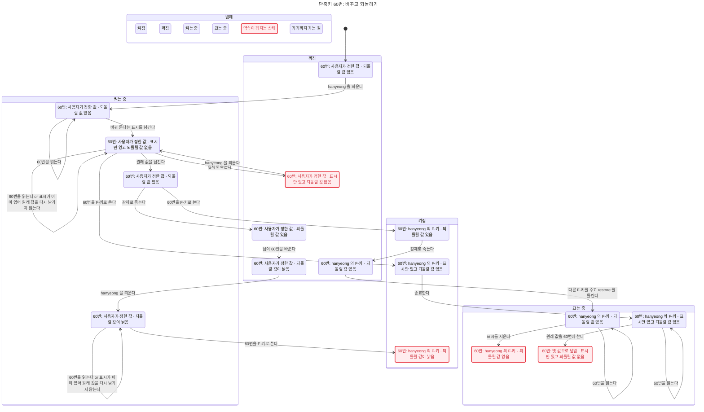

# 정형 검증: 단축키 60번을 바꾸고 되돌리기

pstack 의 `/create-formal-verification-skill` 흐름을 따라 만들었다. 테스트는 누군가 떠올린 경우만
보고, 이 검사는 정해 둔 범위 안의 모든 순서를 본다. 고칠 때는
아래 ["코드를 바꿀 때"](#코드를-바꿀-때) 를 따른다.

```sh
python3 formal/check.py --replay
```

## 무엇을 왜 골랐나

hanyeong 은 시스템 단축키 60번(`이전 입력 소스 선택`)을 자기 F-키로 바꿔 쓰고 끝날 때 되돌린다.
이 값은 재부팅해도, hanyeong 을 지워도 남는다. 그런데 이 순서를 정하는 코드는 macOS 를 부르는
크레이트에 있어서 테스트가 하나도 없었다. 강제 종료, 다시 띄우기, `restore`, 그 사이에 사용자가 직접
바꾸는 일이 어떤 순서로든 섞일 수 있고, 손으로 쓴 테스트는 그 순서를 다 떠올리지 못한다.

| | |
|---|---|
| 약속 | hanyeong 이 60번에 써 넣은 값은 덮어쓰기 직전의 값으로 되돌릴 수 있는 채로만 남는다. 그래서 60번에는 hanyeong 이 써 넣은 값 아니면 남이 정한 값만 있다 |
| 깨지면 | 한영 전환 단축키가 F-키에 묶인 채 남거나, 사용자가 고른 값이 옛 값이나 기본값으로 덮인다 |
| 도구 | TLA+ 와 TLC 1.7.4. "나쁜 순서가 있는가"를 묻는 질문이라 모델 검사기다 |
| 모델 | [`models/Shortcut60.tla`](models/Shortcut60.tla). 동작 하나가 설정 쓰기 하나다 |
| 코드와의 대응 | [`coverage.json`](coverage.json): 덮는 파일과 해시, 동작마다의 코드 위치, 가정 |

## 결과 (2026-11-17)

지금 코드는 이 범위에서 약속을 지킨다(상태 588개, 규칙 넷).

처음 검사했을 때는 깨졌다. 세 가지 길이 있었고, 셋 다 **강제 종료가 끼어야** 일어났다. 같은 날 고쳤다.
고치기 전의 설계는 `Design = "flag"` 로 모델에 남겨 두었고, 거기서는 지금도 깨진다.

| # | 일어나던 일 | 깨지는 규칙 | 어떻게 고쳤나 |
|---|---|---|---|
| 1 | 강제 종료 뒤 사용자가 60번을 다시 고르고 hanyeong 을 다시 띄우면, 종료할 때 그 선택이 옛 값으로 덮였다 | `KeptIsLatest` | 60번이 우리가 써 넣은 값이 아니면 남아 있던 기록을 믿지 않고 지금 값을 새로 남긴다 |
| 2 | 강제 종료 뒤 다른 `--target` 으로 `restore` 하면, 60번은 F-키에 묶인 채 남고 원래 값은 지워졌다 | `KeptWhileOurs` | 우리 값인지를 이번 실행의 `--target` 이 아니라 기록에 적힌 F-키들로 판단한다 |
| 3 | 표시를 쓰고 원래 값을 쓰기 전에 죽으면, 다음 실행이 끝날 때 60번 항목을 지웠다(기본값이 됐다) | `FlagHasValue` | 써 넣은 F-키들과 원래 값을 한 값으로, 한 번의 쓰기로 남긴다 |

일어나기 어려운 순서였다. 1은 강제 종료와 다시 띄우기 사이에 사용자가 단축키를 직접 바꿔야 하고, 2는
기본값이 아닌 `--target` 을 써야 하고, 3은 연이은 두 번의 쓰기 사이에서 죽어야 한다. 3의 두 쓰기가
따로 남는다는 것은 시험용 설정 도메인으로 확인했다(첫 쓰기 직후에 죽여도 20번 중 20번 남았다,
macOS 27.2).

고치기 전에 셋 다 실제 판단 코드에서 재현했다(재생 테스트, 그때는 `#[ignore]`).
지금은 같은 길이 회귀 테스트로 통과하고, 고친 곳을 하나씩 되돌리면 다시 실패한다.

### 고치기 전에 깨지던 길

`/statechart` 가 `Shortcut60.flag.cfg` 에서 낸 가장 짧은 길이다.

**발견 1** (`KeptIsLatest`, 10걸음)

1. hanyeong 을 띄운다. 60번을 읽고, 표시와 원래 값을 남긴다
2. 60번을 F-키로 쓰기 전에 강제로 죽는다
3. 사용자가 60번을 다른 값으로 바꾼다. 남아 있는 원래 값이 낡는다
4. hanyeong 을 다시 띄운다. 표시가 이미 있어 원래 값을 다시 남기지 않고, 60번을 F-키로 쓴다
5. 이제 종료하면 사용자가 3에서 고른 값이 아니라 그 전의 값으로 되돌아간다

**발견 2** (`KeptWhileOurs`, 9걸음)

1. hanyeong 을 f19 로 띄운다. 원래 값을 남기고 60번을 f19 로 쓴다
2. 강제로 죽는다. 60번은 f19 인 채다
3. `hanyeong restore --target f18` 을 돌린다. 60번이 f18 이 아니라서 "남이 바꿨다"고 보고 표시를 지운다
4. 60번은 f19 인 채로 남고, 되돌릴 값은 없다

**발견 3** (`FlagHasValue` 4걸음, 사용자가 보는 결과인 `OursOrTheirs` 까지 11걸음)

1. hanyeong 을 띄운다. 60번을 읽고 표시를 남긴다
2. 원래 값을 남기기 전에 강제로 죽는다. 표시만 있고 값은 없다
3. hanyeong 을 다시 띄운다. 표시가 이미 있어 원래 값을 남기지 않고, 60번을 F-키로 쓴다
4. 종료한다. "없는 값"으로 되돌려 60번 항목이 지워진다



고치기 전의 설계는 상태가 3,113개라 `/statechart` 는 깨지는 길만 그렸다. 붉은 상태가 약속이 깨지는
곳이다. 지금 코드는 상태가 588개로 그림의 한도(500)를 넘고 깨지는 길이 없어 그림이 없다.

### 지금의 설계

`dev.hanyeong` 설정에 값 하나(`shortcut60.record`)를 남긴다. 그 안에 **써 넣었을 수 있는 F-키들**과
**원래 값**이 함께 있다.

- 켤 때: 60번이 이미 이번 F-키면 아무것도 쓰지 않는다. 60번이 기록에 적힌 F-키 가운데 하나면(강제
  종료로 남은 우리 값이다) 원래 값은 두고 이번 F-키만 기록에 더한다. 그 밖이면 지금의 60번 값을 원래
  값으로 새로 남긴다. 기록을 먼저 쓰고 60번을 쓴다.
- 끌 때: 기록이 없으면 손대지 않는다. 60번이 기록에 적힌 F-키 가운데 하나면 원래 값을 쓰고 기록을
  지운다. 아니면 남이 바꾼 것이므로 기록만 지운다. 60번을 먼저 쓰고 기록을 지운다.
- 그래서 `restore` 는 `--target` 없이도, 어느 F-키로 띄웠던 실행이 남긴 것이든 되돌린다.

고치기 전의 형식(`shortcut60.saved`, `shortcut60.original`)이 남아 있으면 읽어서 같은 규칙으로 다루고,
새 기록을 쓰거나 지울 때 함께 지운다. 옛 형식은 어느 F-키를 썼는지 적지 않았으므로 고를 수 있는
F-키 모두를 우리 것으로 본다.

## 범위

- **크기**: F-키 둘(f19, f18), 남이 쓸 수 있는 값 셋(⌃Space, 다른 값, 항목 없음), 한 번에 프로세스
  하나. 횟수 제한은 없다.
- **가정**
  - hanyeong 은 한 번에 하나만 60번을 건드린다(`rivals` 의 확인에 기댄다).
  - `claim`·`release` 한 번이 도는 사이에는 남이 60번을 쓰지 않는다. 쓰면 지금 코드도 지키지 못한다
    ([`models/Shortcut60.midcall.cfg`](models/Shortcut60.midcall.cfg) 가 그것을 보인다). macOS 에는
    이것을 막을 잠금이 없다.
  - 남은 hanyeong 의 F-키와 똑같은 값을 60번에 쓰지 않는다. gksdud 는 쓴다. 그 경우는 범위 밖이다.
- **보지 않은 것**
  - 쓴 값을 살아 있는 단축키에 반영하는 `activateSettings` 의 성공과 실패.
  - 60번 말고 다른 단축키. `Names::write` 는 읽어 둔 사전 전체를 다시 쓴다.
  - 키보드의 키 매핑(`UserKeyMapping`)을 걸고 되돌리는 순서.
  - 옛 형식의 기록을 읽고 지우는 걸음. 재생 테스트가 판단만 확인하고, 실기기에서 한 번 돌려 봤다
    (`docs/perf-progress.md`, 2026-11-17).
  - 통과는 모델과 이 범위에 대한 것이다. 실제 코드 재생은 모델이 찾은 길 몇 개를 판단 함수
    (`shortcut::claim`, `shortcut::release`)로 다시 걷는다. 설정을 쓰는 순서 자체는 `hotkey.rs` 와
    `kept.rs` 를 읽고 옮겨 적은 것이고, 그 파일들이 바뀌면 검사가 멈춘다.

## 검사가 실패할 수 있는가

- **모델**: 고치기 전의 설계(`Shortcut60.flag.cfg`)에서 규칙 넷이 깨진다. 같은 모델, 같은 범위다.
  가정 하나를 풀어도(`Shortcut60.midcall.cfg`) 깨진다.
- **실제 코드**: `check.py --replay` 가 고친 곳을 임시 폴더의 사본에서 하나씩 되돌려 재생 테스트를
  돌린다. 셋 다 모델의 규칙 이름으로 실패해야 통과다.

  | 되돌리는 것 | 잡는 규칙 |
  |---|---|
  | 남아 있는 기록을 60번과 견주지 않고 믿는다(발견 1) | `KeptIsLatest` |
  | 기록에 이번 F-키만 남기고 앞서 쓴 키를 잊는다(발견 2) | `KeptWhileOurs` |
  | 끝날 때 60번이 우리 값인지 보지 않고 되돌린다 | `OursOrTheirs` |

  발견 3(한 번의 쓰기)은 macOS 를 부르는 `kept.rs` 에 있어 이렇게 되돌려 볼 수 없다. 모델의 flag
  설계와, `kept.rs` 가 바뀌면 멈추는 해시가 지킨다.
- **덮는 코드가 바뀌면** `sync_required` 로 멈춘다. 고치기 전에, 판단 하나를 일부러 망가뜨려 이 멈춤과
  재생 테스트의 실패를 둘 다 확인했다.

## 코드를 바꿀 때

`coverage.json` 의 `files` 에 있는 파일을 바꿨으면 해당한다. 파일이 달라도 60번이나 `dev.hanyeong` 설정을
읽고 쓰는 곳을 새로 만들었거나, `claim`·`release` 를 부르는 때(시작, 종료, `restore`, 실행 도중의 다시
걸기)를 바꿨거나, hanyeong 이 둘 이상 함께 돌 수 있게 했으면 해당한다.

`python3 formal/check.py --replay` 를 돌린다. Java 와 `cargo` 가 필요하고, TLC 1.7.4 는 없으면 받아서
`.cache/formal-tools/` 에 두고 체크섬을 확인한다. 시스템 설정은 건드리지 않는다.

| 끝나는 코드 | 뜻 |
|---|---|
| 0 | 약속을 지킨다(모델의 범위 안에서). 출력에 `<- ` 표시가 없고 마지막 줄이 `약속을 지킨다` |
| 1 | 지금 코드가 약속을 깨거나, 결과가 `coverage.json` 의 기록과 다르다 |
| 2 | 판정하지 못했다: 덮는 코드가 바뀌었거나(`sync_required`) 도구가 없다 |

**1 이 나오면** 진짜 버그인지 모델이 틀렸는지부터 가른다. TLC 가 낸 가장 짧은 길은 pstack 의
`/statechart` 로 `models/Shortcut60.view.mjs` 의 말로 읽는다.

1. 그 길을 `crates/hanyeong-core/tests/shortcut60_replay.rs` 에 한 걸음씩 옮긴다. 걸음의 이름은 모델의
   동작 이름과 같다.
2. 실제 코드에서도 같은 규칙에서 실패하면 버그다. 길과 함께 보고한다.
3. 실패하지 않으면 모델이 코드와 다르다. `coverage.json` 의 `steps` 로 그 걸음의 코드를 열어, 모델이 한
   걸음으로 본 것이 코드에서도 한 번의 쓰기인지, 순서가 같은지 보고 모델을 고친다.

**2 가 나오면**(`sync_required`) 모델과 코드를 다시 맞춰 본다.

1. 바꾸는 동안에는 `--replay --while-changing` 으로 끝까지 돌린다. 통과해도 2 로 끝난다.
2. 바뀐 곳을 `coverage.json` 의 `steps` 와 나란히 놓고 쓰기의 순서, 한 번에 쓰는 값의 묶음, "우리
   값인가"의 판단, `claim`·`release` 를 부르는 때를 본다.
3. 동작이 달라졌으면 모델과 재생 테스트의 걸음을 같이 고친다. 의도한 변경이면 `coverage.json` 의 기대
   결과도 고친다. `되돌릴 자리를 찾지 못했습니다` 가 나오면 같은 버그를 새 코드에 다시 넣는 자리를 찾아
   `mutations` 를 고쳐 적는다. 자리가 없어졌다고 그 항목을 지우지 않는다.
4. 모델과 재생 테스트가 지금 코드를 그대로 본뜬다고 확인한 **뒤에만** `--accept-sync` 로 해시를 다시
   적는다.

통과시키려고 규칙이나 모델을 약하게 만들지 않는다. 오래 손대지 않아 많이 어긋났으면 pstack 의
[`maintain-formal-verification-skill`](https://github.com/cursor/plugins/tree/main/pstack/skills/maintain-formal-verification-skill)
을 쓴다.

## 파일

| | |
|---|---|
| `check.py` | TLC 와 재생 테스트를 돌리고 기록과 견준다. 끝나는 코드 0 지킨다 / 1 깬다 / 2 판정 못 함 |
| `coverage.json` | 덮는 파일의 해시, 설정마다 기대하는 결과, 발견, 되돌려 볼 곳 |
| `models/Shortcut60.tla` | 모델 |
| `models/Shortcut60.cfg` | 지금 코드 |
| `models/Shortcut60.flag.cfg` | 고치기 전의 코드. 깨지는 것을 보인다 |
| `models/Shortcut60.midcall.cfg` | 가정의 경계 |
| `models/Shortcut60.view.mjs` | pstack 의 `/statechart` 가 쓰는, 읽는 사람의 말 |
| `../crates/hanyeong-core/tests/shortcut60_replay.rs` | 실제 판단 함수로 길을 다시 걷는 테스트 |
